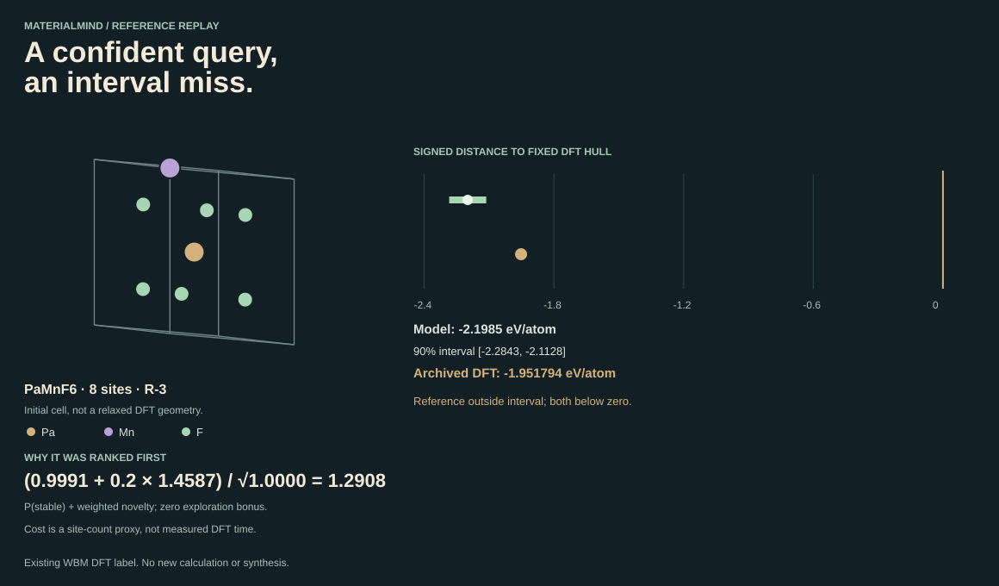
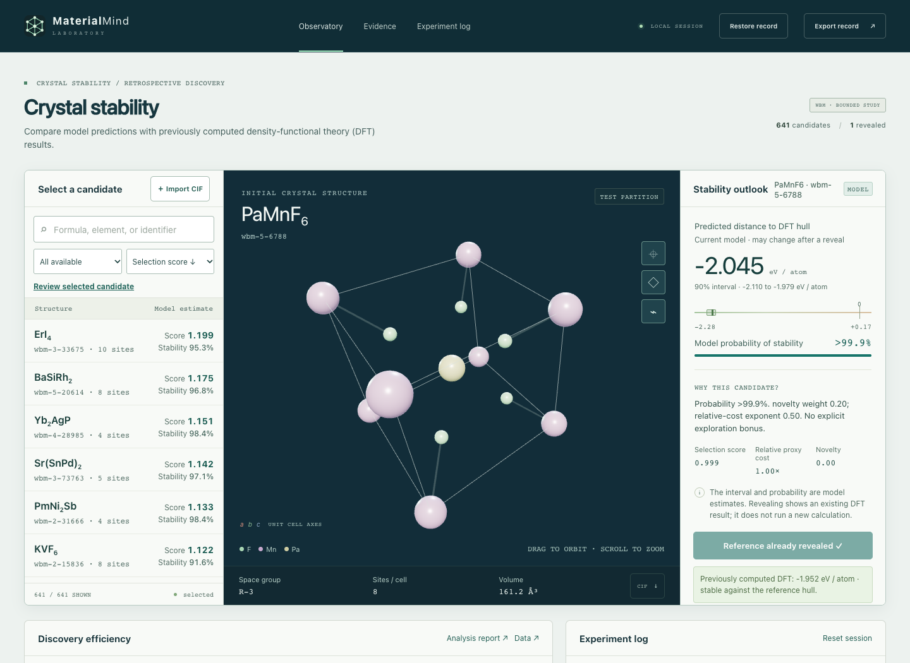
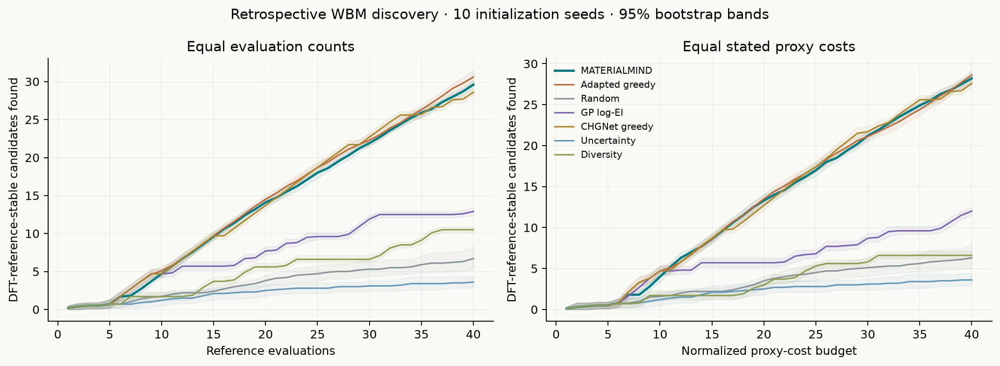
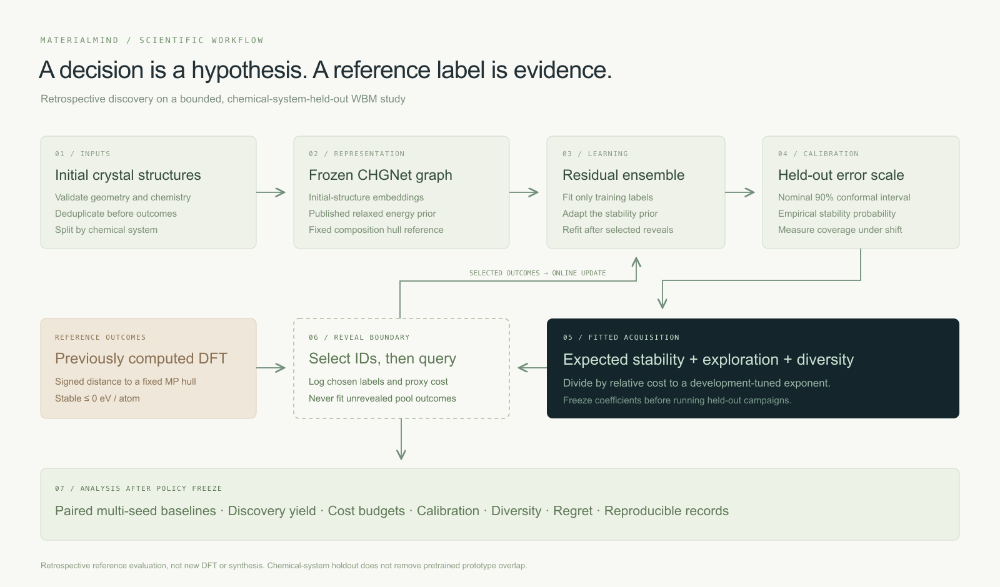
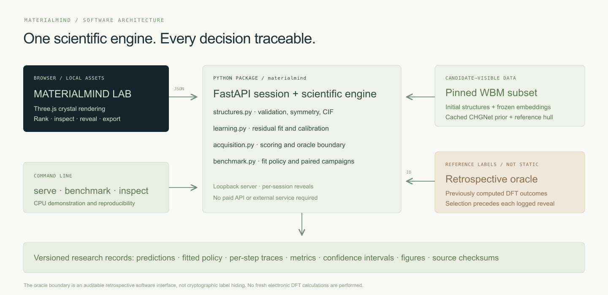

# MaterialMind

<p align="center">
  <a href="LICENSE"></a>
  <a href="DATA_LICENSE.md"></a>
  
</p>

**Choose a crystal. Inspect the model. Reveal what it missed.** MaterialMind is a local research laboratory for comparing crystal-stability predictions and active-learning decisions against **existing computed DFT references**. Rotate real initial cells, inspect uncertainty and query costs, then export and restore the evidence behind a decision.

The selected PaMnF₆ example ranks first but its archived energy falls outside the model's 90% interval. Both energies still satisfy the fixed reference-hull stability criterion. That distinction is the point: a plausible selection is not proof that its uncertainty is reliable.

<picture><source media="(max-width: 600px)" srcset="docs/presentation/query-mobile.svg"></picture>

[Follow the worked case](docs/presentation/README.md) · [Download its native records and runnable source](docs/presentation/worked-example.zip) · [Read the scientific report](docs/REPORT.md)

This release uses **3,072 existing WBM structures**, with **641 candidates in the final chemical-system-held-out pool**. It performs retrospective prediction and label replay, not new DFT, synthesis or an official blind benchmark. The fitted policy **did not outperform adapted greedy** in the released study.

## Run the laboratory

Python **3.11–3.13**, a modern WebGL browser, and a CPU are enough. No API key, account,
GPU, Node build, or external service is required for the demonstration.

```bash
git clone https://github.com/nazeeh111/MaterialMind.git
cd MaterialMind
python3 -m venv .venv
source .venv/bin/activate
pip install -e .
materialmind serve
```

Open **http://127.0.0.1:8765**. If that port is occupied, use `materialmind serve --port 8767`.
The package includes frozen graph features and source predictions, so the demo does not
download a model. First startup fits the small residual model from the included data.
The server is intended for local research and binds to loopback.

1. Select a candidate to inspect its actual initial unit cell, composition, and symmetry.
2. Compare its signed hull-distance estimate, 90% calibrated interval, stability probability,
   structural novelty, and stated cost proxy.
3. Reveal a **previously computed DFT reference**. The session updates its surrogate using
   that label and recalculates its rankings. Unselected labels remain absent from the API catalog.
4. Inspect the saved benchmark under different evaluation or proxy-cost budgets. Export a
   CIF or a complete session record with crystal coordinates, predictions, model revision,
   decision history, and revealed references. Imported geometry remains in the downloaded
    record after a reset. Use **Restore record** to resume a schema-3 export, including
    the original reveal batches and rebuilt models. Session state lives in server memory;
    export before closing the server. Restore replaces only the current browser session
    and requires a matching dataset, policy, code and scientific environment. To reuse
    eligible older choices under the current model, explicitly choose **Replay as new**;
    original predictions remain unverified and the new session records that origin.

See [portable sessions](docs/SESSIONS.md) for the replay contract, API, limits and recovery.

CIF import validates ordered periodic geometry. A matching catalog structure receives the
cached prediction workflow. A new structure is shown as geometry only until a compatible
relaxed-energy prediction and composition reference are supplied. The application does not
invent a stability estimate for an unsupported imported composition.

## Inside the local workbench



*This capture is after the reveal and refit. The current estimate differs from the selection-time prediction preserved in the worked case. [Phone view](docs/presentation/workbench-mobile.png) · [Save and restore contract](docs/SESSIONS.md) · [20-second launch film](https://github.com/nazeeh111/MaterialMind/releases/download/v0.1.0/launch.mp4) · [Editable film source](docs/launch).*

## What the experiment found

The fitted policy recovered **29.6 stable candidates at 40 evaluations**, versus **6.7** for
random and **30.6** for adapted greedy. It did not outperform adapted greedy. Calibration
did not improve discovery yield, and the development-selected diversity term hurt final
performance. The released policy remains frozen; the simpler winning ablation is a diagnostic,
not a newly validated replacement.



The study is reproducible and its negative results are part of the release. Read the
[complete report](docs/REPORT.md) for all eleven strategies, paired intervals, uncertainty
measurements, compute and limitations.

## The experiment

The research question is deliberately falsifiable: **does calibrated uncertainty, diversity,
and cost-aware selection recover more DFT-reference-stable candidates than simple ranking?**

The implemented method combines frozen **CHGNet 0.3.0 crystal-graph embeddings**, 20 initial
geometry/composition descriptors, an **ExtraTrees residual ensemble**, held-out uncertainty
calibration, and a small acquisition model fitted through development-only policy search.
Both the regression head and acquisition coefficients are trained here. The pretrained
atomistic model itself is frozen.



For candidate \(x\), the selection score is

```text
[ P(stable | x) + α × calibrated exploration + β × embedding novelty ]
─────────────────────────────────────────────────────────────────────
                 relative evaluation-cost proxy ^ η
```

The coefficients `α`, `β`, and `η` are selected from 12 declared settings using two
development initialization seeds. They are serialized and hashed before final test
trajectories are generated. Online updates use only already revealed candidates.

The final comparison includes random selection, raw CHGNet greedy ranking, adapted
property-greedy ranking, uncertainty sampling, diversity sampling, and an exact
fixed-kernel Gaussian-process expected-improvement baseline computed in log space.
Ablations remove calibration, diversity, cost, and online surrogate updates.

All methods receive the same initial five random evaluations and the same pool for each
of ten seeds. Results are compared at **40 evaluations** and **40 normalized proxy-cost
units**. The proxy is `1 + (initial site count / 16)^3`, divided by the training median.
It represents a stated computational preference, not measured DFT runtime or money.

See [the technical report](docs/REPORT.md) for actual outcomes, paired confidence intervals,
calibration behavior, failures, and the scope of the evidence. Machine-readable outputs,
all selection traces, and quantitative figures are in [`materialmind/artifacts`](materialmind/artifacts).

## Reproduce and extend

Replay the complete stored-data experiment:

```bash
pip install -e '.[dev,research]'
pytest -q
OPENBLAS_NUM_THREADS=1 OMP_NUM_THREADS=1 materialmind benchmark --out local-runs/reproduction
```

The run fits on training labels, calibrates on a separate split, tunes the policy on
development episodes, freezes it, then generates all final trajectories before calculating
full-pool metrics. The exact source-file identifiers, checksums, selection rule, achieved
partition sizes, feature runtime and overlap audit are in
[`materialmind/data/provenance.json`](materialmind/data/provenance.json).

Rebuild the dataset and actual graph features from upstream inputs:

```bash
pip install -e '.[atomistic,research]'
python scripts/download_sources.py .cache/raw
python scripts/prepare_data.py --raw .cache/raw --output local-runs/rebuilt-data --size 3072
```

For the original environment's complete pinned packages, use
[`requirements-research.lock`](requirements-research.lock). On macOS installations where
Matplotlib system-font enumeration fails, set `MPL_IGNORE_SYSTEM_FONTS=1` and a writable
`MPLCONFIGDIR`; bundled DejaVu fonts suffice. No system permission change is needed.

Useful commands:

```bash
materialmind provenance
materialmind inspect examples/catalog-crystal.cif
materialmind rank --top 20 --out local-runs/ranked-candidates.json
materialmind report --out local-runs/analysis.md
materialmind benchmark --seeds 2 --budget 10 --out local-runs/smoke
```

The smaller command checks execution; its output is not the ten-seed release study.
Programmatic routes are documented at `/api/docs` while the server runs. Python entry
points are `learning.fit_model`, `learning.predict`, `acquisition.rank_candidates`, and
`benchmark.run_study`. New datasets must supply the same visible-feature/reference-state
contract and keep outcomes behind the reveal interface.

## Scientific boundaries

- **Stability definition:** signed energy distance to a fixed MP2020-corrected Materials
  Project DFT hull, in eV/atom. Stable means `distance <= 0`. Negative distances are valid
  below the existing reference hull; this is not a newly reconstructed convex hull.
- **Reference consistency:** published CHGNet formation energy minus the fixed composition
  hull energy. MP2020 corrections are already present and are not applied twice.
- **Data separation:** chemical systems are disjoint across train (1,360), calibration
  (540), development (531), and final test (641). Initial anonymous prototypes still overlap:
  **213** between train and test. No prototype-transfer or independent-pretraining claim follows.
- **Pretraining:** MPtrj contains prototypes overlapping WBM. Adapting on WBM labels makes
  this a separate retrospective study, not an official blind benchmark submission.
- **Uncertainty:** calibration is empirical. Chemical shift and adaptive selection can
  violate the assumptions behind conformal coverage. Interval coverage, probability error,
  and discovery yield are measured separately.
- **Statistical scope:** seed bootstrap intervals describe variation on one fixed test
  pool. They are not independent samples of the universe of inorganic chemistry.
- **Physical scope:** potential predictions, archived DFT, prospective electronic-structure
  calculation, and experimental synthesis are different evidence. This release performs
  the first two only; constrained structure generation is deferred.

## Architecture and research record



| Artifact | Purpose |
|---|---|
| [Technical report](docs/REPORT.md) | Methods, measured outcomes, ablations and failures |
| [Model card](docs/MODEL_CARD.md) | Training, calibration, intended use and limits |
| [Foundations](docs/FOUNDATIONS.md) | Primary-source investigation, alternatives and licenses |
| [Reproduction guide](docs/REPRODUCIBILITY.md) | Exact commands and artifact verification |
| [Data attribution](DATA_LICENSE.md) | CC BY 4.0 data and upstream scientific credit |
| [Contributing](CONTRIBUTING.md) | How to propose and verify improvements |

The release uses editable SVG diagrams and plots generated directly from experiment
outputs. [CHGNet](https://github.com/CederGroupHub/chgnet),
[pymatgen](https://github.com/materialsproject/pymatgen), and
[Matbench Discovery](https://github.com/janosh/matbench-discovery) are the implemented foundations.
See the [foundation review](docs/FOUNDATIONS.md) for methods, alternatives, and limitations.

Code: **MIT**. WBM and published benchmark data: **CC BY 4.0**. Three.js: **MIT**.
Please cite MaterialMind using [`CITATION.cff`](CITATION.cff), and credit the original WBM,
Matbench Discovery, and CHGNet papers listed in [data attribution](DATA_LICENSE.md).

## Label-blind batch suggestions

`materialmind suggest --count 5` returns an initial held-out batch using the
released policy, with within-batch novelty updates. Unlike taking the top five
rows of a static ranking, each subsequent choice accounts for the locations
already chosen in that batch. The fitted model and calibration remain fixed
throughout selection; no reference labels are revealed or synthetic labels fitted.
Use `--out batch.json` to save the suggestions. This command starts from the
initial training state and does not resume a browser session.

For a running session, `GET /api/recommendations?count=5` uses its current model
and excludes already revealed candidates. It returns ordered IDs, predictions and
score components with the current `model_revision`, without changing session
history. Review the suggestions, then `POST /api/reveal` with the chosen IDs
together to reveal and refit once. A later session change can make suggestions
stale; obtain a new recommendation after changing or restoring the session.
Counts are limited to 1–20 and an exhausted pool returns fewer suggestions.
The API is available through the local interactive docs at `/api/docs`.

This exposes the existing batch acquisition idea as a practical workflow. It does
not retune the released study, alter its artifacts, establish an improvement in
discoveries or evaluate new physical structures.

The browser's **Suggest a batch** action previews 1, 3, 5, 10 or 20 candidates
without revealing references. Cancel a preview freely. **Reveal this batch**
commits the whole current preview with one model refit. If another tab changes
the session, the server refuses the stale preview; refresh and preview again.
If a commit response is lost, refresh the session before taking another action.

For agent clients, recommendations now include an opaque `snapshot` and
`requested_count`. Send those two values to
`POST /api/recommendations/reveal` as `{ "count": 5, "snapshot": "..." }`.
The server recomputes the ordered batch from the unchanged session under its lock;
client predictions and reference labels are never consumed. Snapshot checks cover
same-revision restore/reset changes as well as ordinary reveals. This digest is a
consistency guard, not authentication. A duplicate or stale commit returns 409.
Sequential within-batch score semantics are retained in each replay batch's
`selection_mode`, so export and strict restore reproduce the recorded evidence.

### Audit public discovery summaries

The audit-only command checks every strategy's reported count-budget and
proxy-cost-budget discovery mean and 95% bootstrap interval against its saved
reveal traces, using the original seed aggregation and bootstrap calculation.
Malformed, non-finite or inconsistent headlines are refused before any artifact
is rewritten. Keep the original study files when inspecting a modified copy.
The candidate-data hash covers the candidate table. Training-only oracle labels
that the saved traces never use can change without affecting this check.
