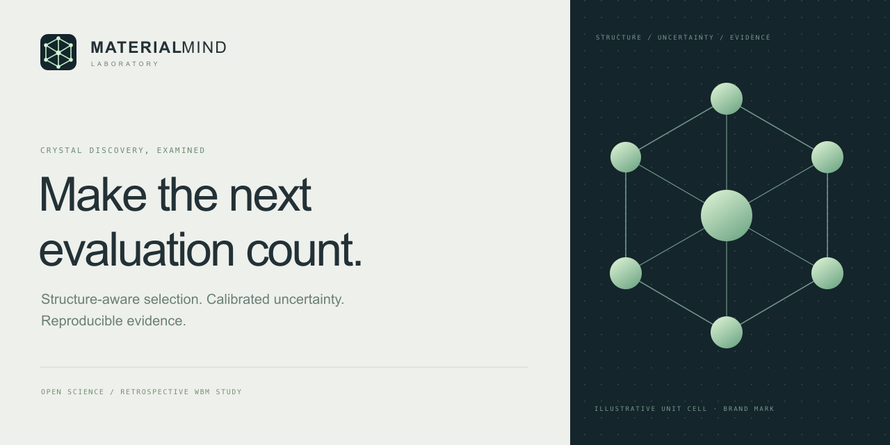
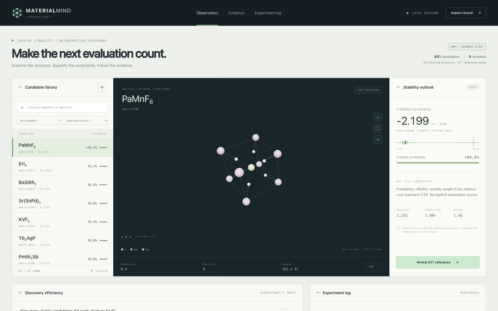
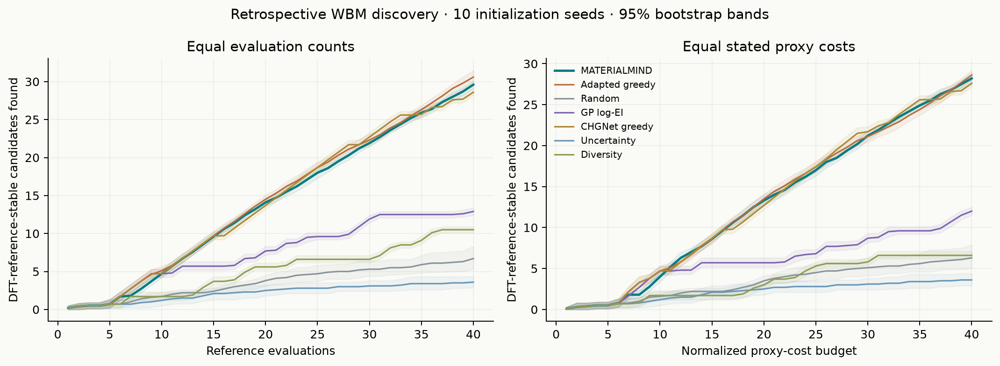
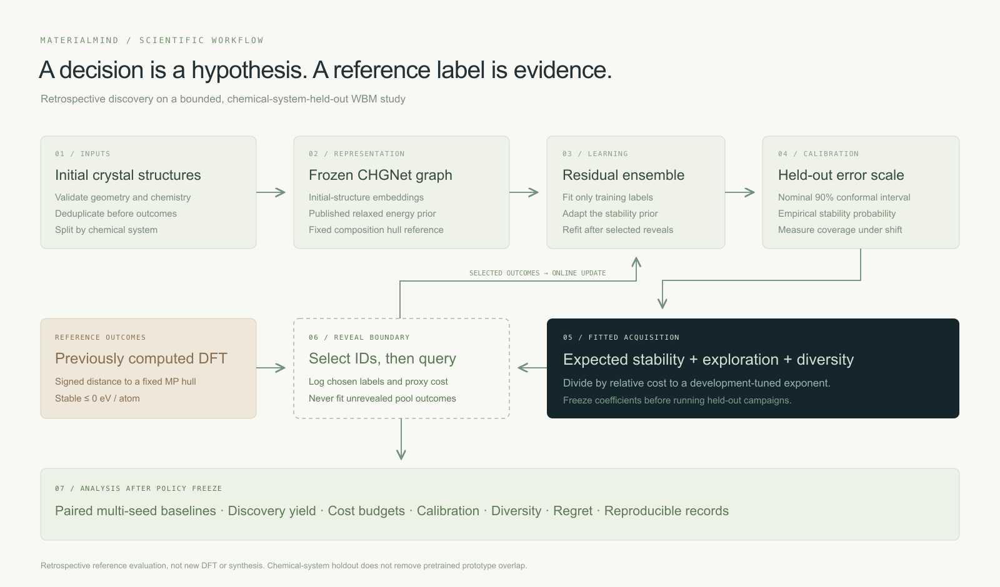
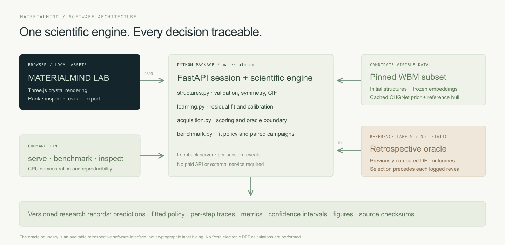

<p align="center"></p>

<p align="center">
  <a href="https://github.com/nazeeh111/MaterialMind/actions"></a>
  <a href="LICENSE"></a>
  <a href="DATA_LICENSE.md"></a>
  
</p>

**Which crystal deserves the next expensive evaluation?** MATERIALMIND is an open research
laboratory for testing that decision. Inspect real crystal structures, adapt a pretrained
atomistic model, calibrate its uncertainty, and compare active-learning policies against
previously computed density-functional-theory (DFT) reference labels.

This release studies **3,072 existing WBM structures**, with **641 candidates in a final
chemical-system-held-out pool**. It trains a residual stability model and fits acquisition
coefficients on separate development campaigns. It does not claim new DFT calculations,
synthesis, novel materials, a world-first acquisition algorithm, or an official blind
Matbench Discovery score.



*The running local application with an actual WBM initial crystal and fitted-model outputs.*

[Watch the 20-second launch film](https://github.com/nazeeh111/MaterialMind/releases/download/v0.1.0/launch.mp4) · [Editable film source](docs/launch)

## Run the laboratory

Python **3.11–3.13**, a modern WebGL browser, and a CPU are enough. No API key, account,
GPU, Node build, or external service is required for the demonstration.

```bash
git clone https://github.com/nazeeh111/MaterialMind.git
cd MaterialMind
python3 -m venv .venv
source .venv/bin/activate
pip install -e .
materialmind serve
```

Open **http://127.0.0.1:8765**. If that port is occupied, use `materialmind serve --port 8767`.
The package includes frozen graph features and source predictions, so the demo does not
download a model. First startup fits the small residual model from the included data.
The server is intended for local research and binds to loopback.

1. Select a candidate to inspect its actual initial unit cell, composition, and symmetry.
2. Compare its signed hull-distance estimate, 90% calibrated interval, stability probability,
   structural novelty, and stated cost proxy.
3. Reveal a **previously computed DFT reference**. The session updates its surrogate using
   that label and recalculates its rankings. Unselected labels remain absent from the API catalog.
4. Inspect the saved benchmark under different evaluation or proxy-cost budgets. Export a
   CIF or the session's predictions, decision record, and revealed references.

CIF import validates ordered periodic geometry. A matching catalog structure receives the
cached prediction workflow. A new structure is shown as geometry only until a compatible
relaxed-energy prediction and composition reference are supplied. The application does not
invent a stability estimate for an unsupported imported composition.

## What the experiment found

The fitted policy recovered **29.6 stable candidates at 40 evaluations**, versus **6.7** for
random and **30.6** for adapted greedy. It did not outperform adapted greedy. Calibration
did not improve discovery yield, and the development-selected diversity term hurt final
performance. The released policy remains frozen; the simpler winning ablation is a diagnostic,
not a newly validated replacement.



The study is reproducible and its negative results are part of the release. Read the
[complete report](docs/REPORT.md) for all eleven strategies, paired intervals, uncertainty
measurements, compute and limitations.

## The experiment

The research question is deliberately falsifiable: **does calibrated uncertainty, diversity,
and cost-aware selection recover more DFT-reference-stable candidates than simple ranking?**

The implemented method combines frozen **CHGNet 0.3.0 crystal-graph embeddings**, 20 initial
geometry/composition descriptors, an **ExtraTrees residual ensemble**, held-out uncertainty
calibration, and a small acquisition model fitted through development-only policy search.
Both the regression head and acquisition coefficients are trained here. The pretrained
atomistic model itself is frozen.



For candidate \(x\), the selection score is

```text
[ P(stable | x) + α × calibrated exploration + β × embedding novelty ]
─────────────────────────────────────────────────────────────────────
                 relative evaluation-cost proxy ^ η
```

The coefficients `α`, `β`, and `η` are selected from 12 declared settings using two
development initialization seeds. They are serialized and hashed before final test
trajectories are generated. Online updates use only already revealed candidates.

The final comparison includes random selection, raw CHGNet greedy ranking, adapted
property-greedy ranking, uncertainty sampling, diversity sampling, and an exact
fixed-kernel Gaussian-process expected-improvement baseline computed in log space.
Ablations remove calibration, diversity, cost, and online surrogate updates.

All methods receive the same initial five random evaluations and the same pool for each
of ten seeds. Results are compared at **40 evaluations** and **40 normalized proxy-cost
units**. The proxy is `1 + (initial site count / 16)^3`, divided by the training median.
It represents a stated computational preference, not measured DFT runtime or money.

See [the technical report](docs/REPORT.md) for actual outcomes, paired confidence intervals,
calibration behavior, failures, and the scope of the evidence. Machine-readable outputs,
all selection traces, and quantitative figures are in [`materialmind/artifacts`](materialmind/artifacts).

## Reproduce and extend

Replay the complete stored-data experiment:

```bash
pip install -e '.[dev,research]'
pytest -q
OPENBLAS_NUM_THREADS=1 OMP_NUM_THREADS=1 materialmind benchmark --out local-runs/reproduction
```

The run fits on training labels, calibrates on a separate split, tunes the policy on
development episodes, freezes it, then generates all final trajectories before calculating
full-pool metrics. The exact source-file identifiers, checksums, selection rule, achieved
partition sizes, feature runtime and overlap audit are in
[`materialmind/data/provenance.json`](materialmind/data/provenance.json).

Rebuild the dataset and actual graph features from upstream inputs:

```bash
pip install -e '.[atomistic,research]'
python scripts/download_sources.py .cache/raw
python scripts/prepare_data.py --raw .cache/raw --output local-runs/rebuilt-data --size 3072
```

For the original environment's complete pinned packages, use
[`requirements-research.lock`](requirements-research.lock). On macOS installations where
Matplotlib system-font enumeration fails, set `MPL_IGNORE_SYSTEM_FONTS=1` and a writable
`MPLCONFIGDIR`; bundled DejaVu fonts suffice. No system permission change is needed.

Useful commands:

```bash
materialmind provenance
materialmind inspect examples/catalog-crystal.cif
materialmind rank --top 20 --out local-runs/ranked-candidates.json
materialmind report --out local-runs/analysis.md
materialmind benchmark --seeds 2 --budget 10 --out local-runs/smoke
```

The smaller command checks execution; its output is not the ten-seed release study.
Programmatic routes are documented at `/api/docs` while the server runs. Python entry
points are `learning.fit_model`, `learning.predict`, `acquisition.rank_candidates`, and
`benchmark.run_study`. New datasets must supply the same visible-feature/reference-state
contract and keep outcomes behind the reveal interface.

## Scientific boundaries

- **Stability definition:** signed energy distance to a fixed MP2020-corrected Materials
  Project DFT hull, in eV/atom. Stable means `distance <= 0`. Negative distances are valid
  below the existing reference hull; this is not a newly reconstructed convex hull.
- **Reference consistency:** published CHGNet formation energy minus the fixed composition
  hull energy. MP2020 corrections are already present and are not applied twice.
- **Data separation:** chemical systems are disjoint across train (1,360), calibration
  (540), development (531), and final test (641). Initial anonymous prototypes still overlap:
  **213** between train and test. No prototype-transfer or independent-pretraining claim follows.
- **Pretraining:** MPtrj contains prototypes overlapping WBM. Adapting on WBM labels makes
  this a separate retrospective study, not an official blind benchmark submission.
- **Uncertainty:** calibration is empirical. Chemical shift and adaptive selection can
  violate the assumptions behind conformal coverage. Interval coverage, probability error,
  and discovery yield are measured separately.
- **Statistical scope:** seed bootstrap intervals describe variation on one fixed test
  pool. They are not independent samples of the universe of inorganic chemistry.
- **Physical scope:** potential predictions, archived DFT, prospective electronic-structure
  calculation, and experimental synthesis are different evidence. This release performs
  the first two only; constrained structure generation is deferred.

## Architecture and research record



| Artifact | Purpose |
|---|---|
| [Technical report](docs/REPORT.md) | Methods, measured outcomes, ablations and failures |
| [Model card](docs/MODEL_CARD.md) | Training, calibration, intended use and limits |
| [Foundations](docs/FOUNDATIONS.md) | Primary-source investigation, alternatives and licenses |
| [Reproduction guide](docs/REPRODUCIBILITY.md) | Exact commands and artifact verification |
| [Data attribution](DATA_LICENSE.md) | CC BY 4.0 data and upstream scientific credit |
| [Contributing](CONTRIBUTING.md) | How to propose and verify improvements |

Google Research's PaperVizAgent was investigated. Its documented rendering route requires
external model APIs, so the release uses editable, locally authored SVG diagrams and
plots generated directly from experiment outputs. [CHGNet](https://github.com/CederGroupHub/chgnet),
[pymatgen](https://github.com/materialsproject/pymatgen), and
[Matbench Discovery](https://github.com/janosh/matbench-discovery) are the implemented foundations.
MatGL, Matbench, BoTorch, eSEN and FAIRChem were investigated and documented rather than
listed as unimplemented integrations. See the [foundation review](docs/FOUNDATIONS.md).

Code: **MIT**. WBM and published benchmark data: **CC BY 4.0**. Three.js: **MIT**.
Please cite MATERIALMIND using [`CITATION.cff`](CITATION.cff), and credit the original WBM,
Matbench Discovery, and CHGNet papers listed in [data attribution](DATA_LICENSE.md).
