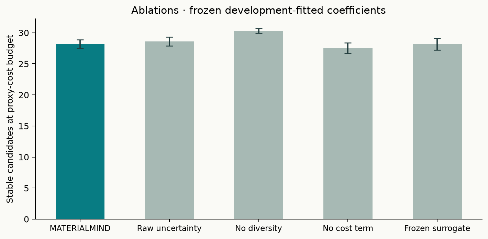
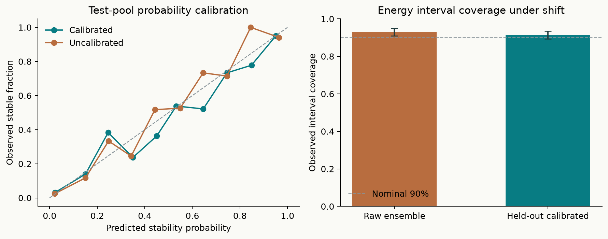

# MATERIALMIND: uncertainty-aware selection in a bounded retrospective WBM study

**Release 0.1.0 · 26 October 2026 · Previously computed DFT references**

## Main result

The development-fitted acquisition policy found substantially more reference-stable crystals
than random selection, but **did not outperform adapted property-greedy ranking**. Uncertainty
calibration did not improve discovery yield on this final pool. A diversity term selected on
development data reduced final performance. Online surrogate updates did not show an endpoint
benefit. These are the study's findings, not defects concealed through test-driven retuning.

The contribution is a trained residual model, a fitted and inspectable acquisition policy,
an auditable retrospective experiment, and a working research laboratory. This release does
not establish an unprecedented algorithm, a discovery-efficiency breakthrough, new DFT
calculations, synthesized materials, or an official blind Matbench Discovery score.

## Question and experimental boundary

We tested whether calibrated stability probabilities, uncertainty exploration, structural
diversity and a stated evaluation-cost preference improve stable-candidate recovery over
established finite-pool selection strategies. The experiment starts from existing WBM
initial structures with published CHGNet predictions and archived DFT labels. It simulates
revealing an expensive evaluation; it does not run a DFT solver.

The target is the **signed distance to the fixed MP2020-corrected Materials Project DFT hull**,
in eV/atom. A distance <= 0 is reference-stable. Negative values are retained. The fixed
composition reference is reference formation energy minus reference signed hull distance;
the prior distance is published CHGNet formation energy minus that reference. This follows
the benchmark's reference convention and does not rebuild a convex hull from this subset.
MP2020 corrections are not applied twice. Reference stability does not establish synthesis,
kinetic persistence or useful material properties.

### Input-only selection and partitions

The source collection is Matbench Discovery's public CC BY 4.0 WBM archive. File IDs,
MD5/SHA256 checksums and transformations are recorded in
[`provenance.json`](../materialmind/data/provenance.json). Selection uses initial structures
with 2–4 elements, 2–24 sites, ordered occupancy, finite valid cells and no periodic contacts
shorter than 0.55 Å. Eligible IDs are ordered by a fixed SHA256 rule, initial duplicates are
checked using StructureMatcher, and 3,072 structures are retained. No stability, prediction
error, relaxed geometry or outcome-dependent prototype flag is used to choose the sample.
All retained inputs also passed the strengthened skew-cell periodic-self-image validation.

| Partition | Candidates | Role |
|---|---:|---|
| Training | 1,360 | Fit residual regressor and feature projection |
| Calibration | 540 | Estimate signed residual distribution and interval multiplier |
| Development | 531 | Fit acquisition coefficients using two retrospective campaigns |
| Final test | 641 | Generate frozen-policy discovery trajectories; 119 reference-stable |

Chemical-system hashes assign partitions; every chemical-system intersection is empty.
Polymorphs of a composition therefore remain together. **213 anonymous initial prototypes
overlap training and test**, and CHGNet's MPtrj pretraining contains prototypes overlapping
WBM. Neither prototype transfer nor independent pretrained-backbone generalization is
established. Adapting on part of WBM makes this a separate study, not a blind leaderboard result.

## Learned model and acquisition

CHGNet 0.3.0 remains frozen. Its published relaxed formation-energy outputs supply the energy
prior. Locally computed 64-dimensional graph features use initial, unrelaxed structures;
the interface displays those initial structures, not locally or DFT-relaxed geometry.
Twenty initial cell/composition descriptors supplement the features.

A 40-tree ExtraTrees ensemble learns the residual between the prior and DFT signed hull
distance. Training-only scaling and PCA supply diversity coordinates. The model is refitted
after each batch of five using base training labels plus previously revealed candidates.
The calibration split remains reserved. Full details are in [MODEL_CARD.md](MODEL_CARD.md)
and [ENGINE_METHOD.md](ENGINE_METHOD.md).

Raw ensemble disagreement receives a 0.01 eV/atom floor. Held-out standardized residuals
provide a finite-sample split-conformal nominal-90% interval and an empirical residual CDF
for stability probability. This is empirical calibration under chemical shift, not a
guaranteed per-crystal error bar or Bayesian posterior.

The score combines stability probability, calibrated interval exploration and nearest-known
graph-feature novelty, divided by relative proxy cost to a fitted exponent. A declared
12-setting search on development seeds 811/812 selected **exploration 0, diversity 0.2,
cost exponent 0.5**. Thus an explicit uncertainty bonus was not selected; calibration still
affects the probability term. The policy was serialized and hashed before test trajectories:

`f0985a1234f0ffcbcb2a60e25e0cccf0b3504bcd5a997b87cd39a24ea72bda70`

## Comparisons and statistics

All eleven methods use the same final pool, batch size, and five initial random evaluations
for each of ten paired seeds (0–9). Initial evaluations count against the budgets. Labels
are revealed only after each batch has been fixed. Full-pool analysis follows generation of
all trajectories. The oracle is an auditable software interface; distributed local labels
are not cryptographically hidden.

Budgets are **40 reference evaluations** and **40 normalized proxy-cost units**. The raw
proxy is `1 + (initial site count / 16)^3`, divided by its training median. It is not measured
DFT compute time, energy use or money. A trajectory continues until both horizons are covered;
count metrics use the first 40 evaluations, and cost metrics use the longest prefix that does
not overspend 40 units. The latter may leave a small unused remainder.

The GP baseline uses all known training/revealed labels, a CHGNet prior mean, training-frozen
PCA coordinates, a fixed RBF kernel and stable log expected improvement. Its incumbent is
from revealed pool candidates. It is a standard EI ranking with fixed hyperparameters,
not an extensively tuned BoTorch baseline. The audit confirmed 636 distinct finite first-batch
log-EI scores; three direct-EI values would have numerically underflowed without the stable form.

### Stable candidates recovered

Means and 95% bootstrap intervals over ten initialization seeds on this one fixed pool:

| Strategy | At 40 evaluations | At 40 proxy-cost units |
|---|---:|---:|
| Random | 6.7 [5.3, 8.3] | 6.3 [5.0, 7.9] |
| Published CHGNet greedy | 28.6 [28.2, 29.1] | 27.6 [27.2, 28.1] |
| Adapted greedy | 30.6 [29.5, 31.5] | 28.6 [28.0, 29.2] |
| Uncertainty sampling | 3.6 [2.9, 4.4] | 3.6 [2.9, 4.4] |
| Diversity sampling | 10.5 [10.1, 10.9] | 6.6 [6.2, 7.1] |
| Fixed-kernel GP log-EI | 12.9 [12.4, 13.4] | 12.0 [11.5, 12.5] |
| **MATERIALMIND** | **29.6 [29.1, 30.1]** | **28.2 [27.5, 28.9]** |
| Uncalibrated ablation | 30.3 [29.6, 31.0] | 28.6 [27.9, 29.3] |
| No diversity ablation | 31.5 [31.0, 32.0] | 30.3 [29.9, 30.7] |
| No cost ablation | 30.0 [29.3, 30.8] | 27.5 [26.7, 28.4] |
| Frozen surrogate ablation | 29.6 [28.7, 30.4] | 28.2 [27.2, 29.1] |

At count 40, the fitted policy's precision is **74.0%** and recall of the pool's 119 stable
candidates is **24.87%**. The paired difference from adapted greedy is −1.0 discoveries
[−1.8, 0.0]; at cost 40 it is −0.4 [−1.1, 0.3]. These results do not support superiority over
adapted greedy. The paired advantage over the published CHGNet greedy prior is +1.0
[0.6, 1.4] at count 40, but a better regression head and a better policy are distinct claims.

### Ablations and failures

- **Calibration:** fitted-minus-uncalibrated discovery difference is −0.7 [−1.0, −0.4] at
  count 40 and −0.4 [−1.0, 0.2] at cost 40. Calibrating the residual distribution did not
  improve discovery efficiency here.
- **Diversity:** removing the development-selected diversity term improves cost-budget yield
  by 2.1 [1.6, 2.7] discoveries. It did not transfer beneficially to this test pool.
- **Cost:** the fitted cost term improves cost-budget yield over its removal by 0.7 [0.1, 1.3],
  within the stated proxy. This does not validate a DFT runtime model.
- **Online updates:** paired mean differences from the frozen surrogate are 0.0 with intervals
  crossing zero. The software updates the model, but this endpoint comparison does not show
  a benefit from updating.
- **Pure uncertainty sampling:** it finds fewer stable candidates than random in this study.
  High error or disagreement is not the same objective as finding stable phases.

The no-diversity ablation is a **post hoc diagnostic**, not a newly independently validated
replacement policy. The released default retains the pretest-fitted weights. A future policy
choice needs another held-out pool or prospective evaluation. No hyperparameter was selected
using the final outcomes reported here.

### Uncertainty measurements

The seed-0 training-only model has MAE **0.05045 eV/atom** [0.04608, 0.05505] and RMSE
0.07671 eV/atom. Calibration transforms do not change its point estimates.

| Quantity | Calibrated | Raw ensemble transform |
|---|---:|---:|
| Brier score, lower is better | 0.09726 | 0.09621 |
| Expected calibration error | 0.03480 | 0.03251 |
| Observed nominal-90% interval coverage | 91.42% | 92.98% |
| Mean interval width, eV/atom | 0.20968 | 0.22367 |

Calibration gives intervals about **6.3% narrower**, with observed coverage closer to nominal
90%, but slightly worse probability-error point estimates. Conditional chemical-system
cluster-bootstrap coverage intervals are [89.26%, 93.49%] calibrated and [90.97%, 94.88%] raw.
These intervals condition on the fitted model/calibration set. They do not guarantee coverage
under chemical shift or adaptive selection. Probability reliability bins, sharpness and
discovery yield must be assessed separately.

### Other recorded metrics

The output includes precision@40, recall under budget, count-normalized discovery AUC,
simple regret, chemical-system count, embedding spread, runtime, model-update count and
actual proxy spending for every method/seed. Discovery AUC is the mean cumulative stable
count over steps 1–40, not a 0–1 score. Simple regret is the best selected reference distance
minus the lowest distance in the pool. Most property-driven strategies find that extreme
minimum, giving zero regret; this metric therefore adds little discrimination here.
See [`metrics.csv`](../materialmind/artifacts/metrics.csv) and
[`summary.json`](../materialmind/artifacts/summary.json) for complete values and intervals.

## Compute and execution record

All local training, feature extraction and selection ran on an ARM64 Mac CPU. The graph
checkpoint was frozen; no large atomistic model was trained. Feature generation used two
PyTorch threads; discovery fits used one ExtraTrees worker with BLAS/OpenMP thread limits.

| Measured stage | Wall seconds | Scope |
|---|---:|---|
| Graph features and final feature assembly | 103.277 | From loaded checkpoint; excludes download/import startup |
| Development fitting interval | 436.108 | Between initial-model and frozen-policy artifact writes |
| Resumed final test invocation | 580.171 | All 110 final trajectories and analysis; excludes prior development |

These are implementation wall times on a shared machine, not intrinsic algorithm speed,
full task duration or DFT cost. Published CHGNet relaxations and historical DFT compute are
upstream work and are not included. Their complete compute cost is unavailable here.

After development fitting, the original invocation completed three test episodes before an
interruption to cache repeated batch calculations. Outcomes were not inspected to choose
settings. A regression test verified identical cached and direct selection. All 110 final
episodes then restarted with the byte-identical frozen policy, without retuning. Essential
timing and the final progress log are in [`artifacts/execution`](../materialmind/artifacts/execution).

## Verification and limits

Independent checks reproduced all 110 traces, shared initializations, reference values,
budget arithmetic, metric means, 880 curve means, paired discovery intervals, calibration
cluster intervals and dataset/policy hashes. Current figures were inspected visually.
The independent reports are in [`docs/review`](review/).

Software checks cover numerical routines, oracle access, exact GP tails, cached/direct
equivalence, frozen-update ablation, CIF roundtrips, scaled-geometry import rejection,
skewed periodic self-overlap, API label hiding and reveal idempotence. The live initial
predictions are also checked against the frozen research outputs. Local demonstration
requires no PyTorch, GPU, API key or external account after installation.

This remains one bounded chemistry-held-out pool with ten initialization seeds, a small
policy search, synthetic costs, a fixed-kernel BO comparator and possible pretrained-model
overlap. Seed confidence intervals do not establish generalization to all chemistry, and
we did not adjust for the many exploratory comparisons. Fresh prospective evaluation,
better cost measurements, stronger backbone/BO comparisons and new untouched partitions
are needed before recommending the learned policy for expensive physical work.

Sources and attribution: [FOUNDATIONS.md](FOUNDATIONS.md), [DATA_LICENSE.md](../DATA_LICENSE.md).
Reproduction: [REPRODUCIBILITY.md](REPRODUCIBILITY.md). Portable measured summary:
`materialmind report --out analysis.md` or the local `/api/report` endpoint.
