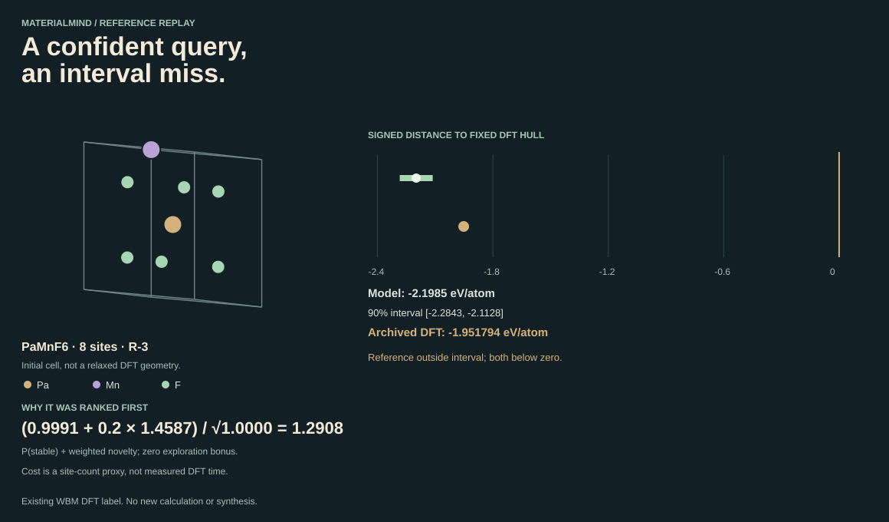

# One query, three different kinds of evidence

This worked case uses the archived MaterialMind runtime included in the download and existing public WBM data. It does not execute DFT, train CHGNet, collect a measurement or rerun the release study.

1. **Inspect and select.** The initial `PaMnF6` cell (`wbm-5-6788`, eight sites, space group `R-3`) ranks first among 641 held-out candidates. The pre-reveal model predicts **−2.1985497267 eV/atom**, with a 90% interval **[−2.2843204176, −2.1127790357]** and stability probability **0.9990757856**. Its acquisition score is `(P + 0.2 × novelty) / sqrt(relative_cost)` = **1.2908064353**. The released exploration coefficient is zero. Cost is a site-count proxy, not measured runtime.
2. **Reveal an archived reference.** The already computed WBM DFT label is **−1.951794 eV/atom**. It is outside that interval, although both predicted and reference energies are below the fixed hull's zero threshold. A high stability probability does not establish an accurate energy interval. One chosen example does not estimate interval coverage or strategy advantage.
3. **Edit geometry without inventing a label.** Increase cell volume by 3%, retaining fractional coordinates. The unmatched cell imports as geometry only, without a stability estimate or revealable reference. This is an illustrative edit, not a relaxation or a proposed synthesizable material.
4. **Save and resume.** A schema-3 record preserves the reveal batch and edited geometry. A fresh process and independent browser reconstruct it exactly in the recorded environment, apart from the export timestamp. Invalid CIF and a changed replay checksum are refused while existing state is retained.

<picture><source media="(max-width: 600px)" srcset="query-mobile.svg"></picture>

The unit cell uses an orthonormal orthographic camera basis, one common scale for its atoms and twelve cell edges, and one marker per actual site. It is the **initial** structure, not a DFT-relaxed structure. The energy axis includes zero and preserves the recorded interval and reference coordinates. `figure-data.json` contains the exact numerical inputs; `figure.py` renders them. Rounded display arithmetic is illustrative; the generator checks the full-precision score.

## Inspect the actual artifacts

- [Pre-reveal catalog](before.json), [reveal and selection-time evidence](reveal.json), [post-refit catalog](after.json).
- [Initial CIF](selected.cif), [volume-edited CIF](edited.cif), [geometry-only import result](edited-import.json).
- [Session with reveal and edit](session.json), [actual UI download](ui-session.json), [restore/refusal checks](reopen-check.json), [browser journey](browser.json).
- [Desktop workbench](workbench-desktop.png), [375-pixel phone](workbench-mobile.png).
- [Complete worked bundle](worked-example.zip): runtime source, public data and retained study outputs, native records, exact package versions, upstream notices, and its own local guide and verifier.

The desktop capture is **after the refit**. Its current mean is approximately −2.045 eV/atom, so it intentionally differs from the pre-reveal prediction above. Selection-time outputs remain in the record rather than being replaced with the new model.

## Run and restore

Use the repository's [normal setup](../../README.md#run-the-laboratory). Select `wbm-5-6788`, inspect the cell, reveal its reference, and choose **Export record**. In a fresh browser, choose **Restore record**, load the JSON and confirm replacement. Import `edited.cif` to inspect the geometry-only route. Matching `selected.cif` recovers the cached candidate.

The native JSON has a conservative source/data/policy/runtime contract, not a signature. Its hash detects accidental changes, not authorship. For exact restore of the archived record, use the runtime source and recorded environment in the worked bundle. The current workbench can create and restore its own records. Its **Replay as new** action can reconstruct eligible archived choices using the current model, with the older predictions left unverified. See [portable sessions](../SESSIONS.md).

## Scope and attribution

All energy values are signed distances to the fixed MP2020-corrected Materials Project reference hull, in eV/atom; negative values are valid. Stable here means distance ≤ 0, not experimental synthesis. The 3,072-structure retrospective dataset, chemical-system splits and prototype/pretraining overlap are unchanged.

The frozen ten-seed result remains **29.6** stable candidates at 40 evaluations for the fitted policy versus **30.6** for adapted greedy. This case does not overturn that negative comparison. See the complete [report](../REPORT.md), [model card](../MODEL_CARD.md), [data provenance](../../materialmind/data/provenance.json) and [data credits](../../DATA_LICENSE.md). WBM/Matbench-derived data are CC BY 4.0; code and bundled Three.js retain their MIT notices. No endorsement is implied.
